# UniTasky

UniTasky es una aplicación Android que desarrollé para organizar tareas y actividades académicas de una forma simple. La idea es tener en un solo lugar las asignaturas, fechas de entrega, prioridades, estados y sesiones de enfoque.

## Ficha del proyecto

- **Aplicación:** UniTasky
- **Alumno:** Denzel Álvarez
- **Asignatura:** Programación Android
- **Docente:** Leopoldo Rodríguez
- **Desarrollo:** Android nativo con Java y XML
- **Persistencia:** SQLite local
- **Versión mínima:** Android 10 (`minSdk 29`)

## ¿Qué problema resuelve?

Durante el semestre se pueden acumular tareas de distintas asignaturas y no siempre es fácil recordar qué falta, qué fecha tiene cada entrega o qué actividades ya fueron completadas. UniTasky permite guardar y consultar esta información desde el teléfono y también registrar sesiones de enfoque asociadas a una tarea.

## Funcionalidades principales

- Registro e inicio de sesión.
- Sesión de usuario guardada localmente.
- Dashboard con resumen académico.
- Crear, editar, eliminar y completar tareas.
- Búsqueda, filtros y orden de tareas.
- Gestión de asignaturas.
- Vista de próximas entregas.
- Modo Enfoque asociado a una tarea.
- Historial de sesiones de enfoque.
- Uso del sensor de proximidad para el Modo Enfoque.

## Tecnologías utilizadas

- Java 17
- XML
- Android Studio
- Gradle Groovy
- SQLite
- SQLiteOpenHelper
- RecyclerView
- CardView
- SharedPreferences
- ExecutorService
- Sensor de proximidad

## Requisitos

- Android 10 o superior (`minSdk 29`).
- `compileSdk 35`.
- `targetSdk 35`.
- Java 17.
- Android Studio con soporte para SDK 35.

## Instalación y ejecución

1. Clonar o descargar el repositorio.
2. Abrir el proyecto en Android Studio.
3. Esperar la sincronización de Gradle.
4. Seleccionar un emulador o dispositivo con Android 10 o superior.
5. Ejecutar el módulo `app`.

## Base de datos

UniTasky utiliza SQLite para guardar la información de forma local. La organización principal es:

```text
UniTaskyContract → DatabaseHelper → SQLite
```

Las tablas utilizadas son:

- `usuarios`
- `asignaturas`
- `tareas`
- `sesiones_enfoque`

La base de datos mantiene `VERSION_BD = 4`.

## Seguridad y buenas prácticas

El proyecto utiliza medidas básicas de seguridad acordes al alcance académico. Las consultas SQLite utilizan parámetros con `selectionArgs` y las inserciones o actualizaciones trabajan con `ContentValues`. Los `Cursor` se cierran después de usarlos.

Las Activities internas se mantienen con `android:exported="false"`, `allowBackup="false"` está configurado en el Manifest y las pantallas de Login y Registro utilizan `FLAG_SECURE`. Las contraseñas se almacenan mediante hash y `SharedPreferences` conserva solamente la información mínima necesaria para la sesión.

`FileProvider` no se utiliza porque actualmente UniTasky no usa cámara ni comparte archivos mediante URI.

## Capturas del funcionamiento

Estas capturas corresponden al funcionamiento real de UniTasky durante las pruebas del proyecto.

### Pantalla inicial

<p align="center">
  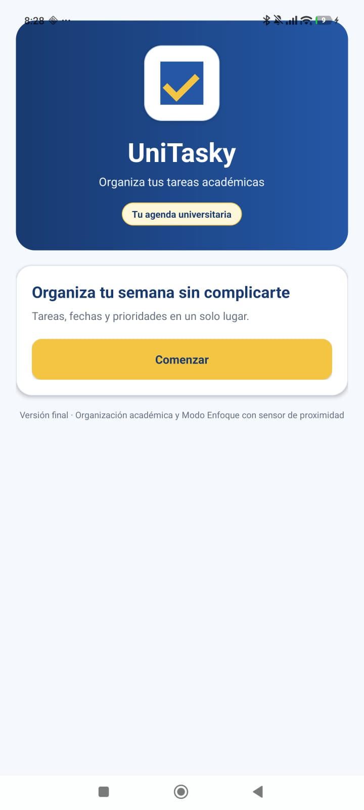
</p>

### Login

<p align="center">
  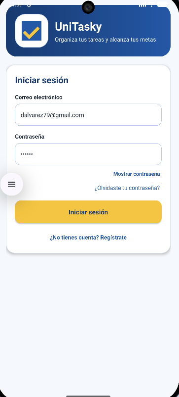
</p>

### Dashboard al iniciar

<p align="center">
  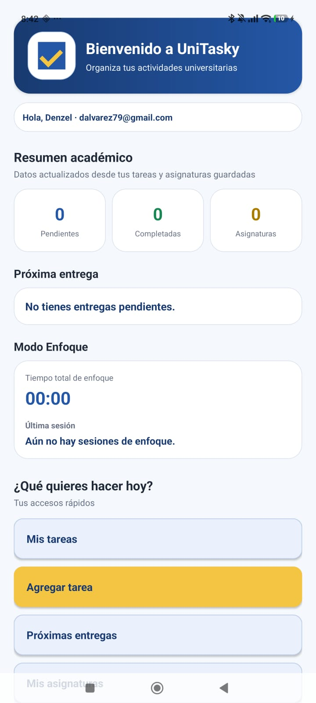
</p>

### Dashboard con información registrada

<p align="center">
  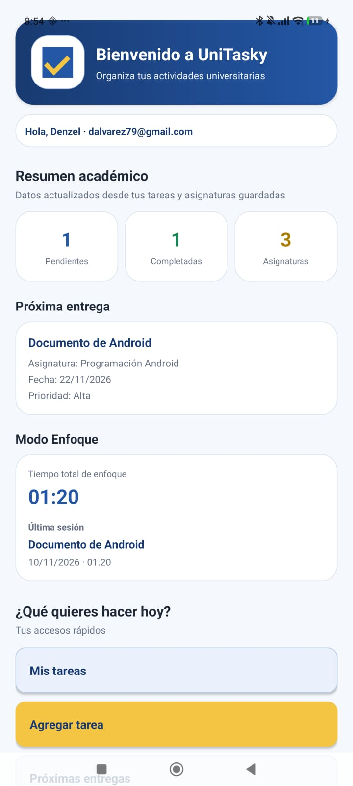
</p>

### Agregar tarea

<p align="center">
  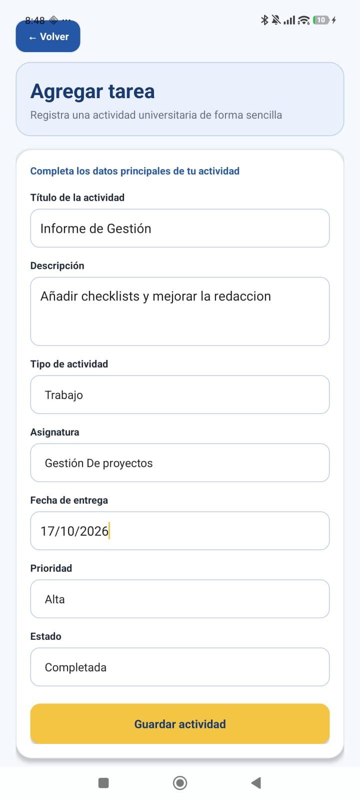
</p>

### Mis tareas

<p align="center">
  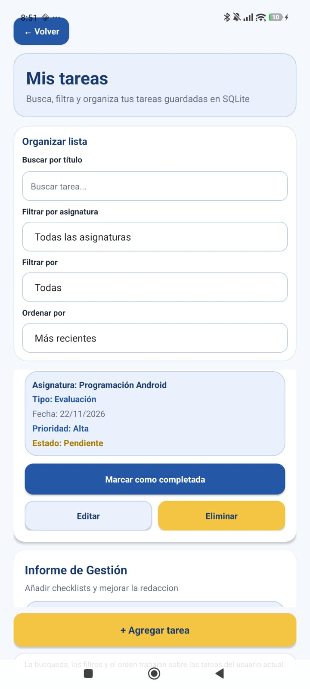
</p>

### Mis asignaturas

<p align="center">
  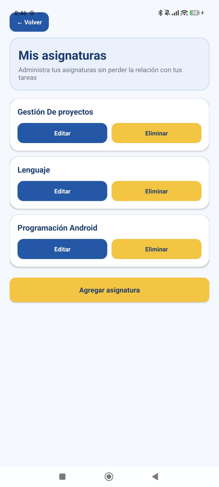
</p>

### Próximas entregas

<p align="center">
  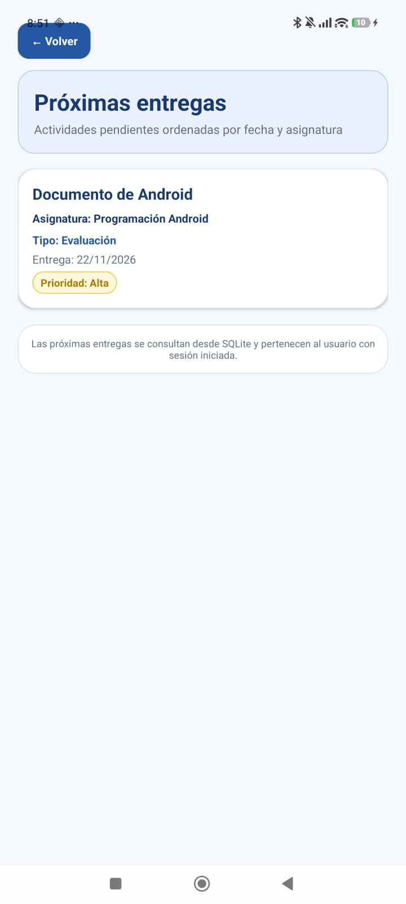
</p>

### Modo Enfoque pausado

<p align="center">
  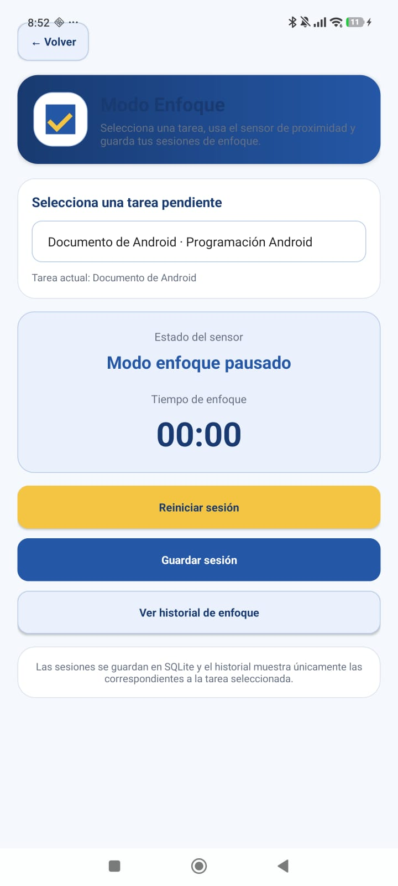
</p>

### Modo Enfoque activo

<p align="center">
  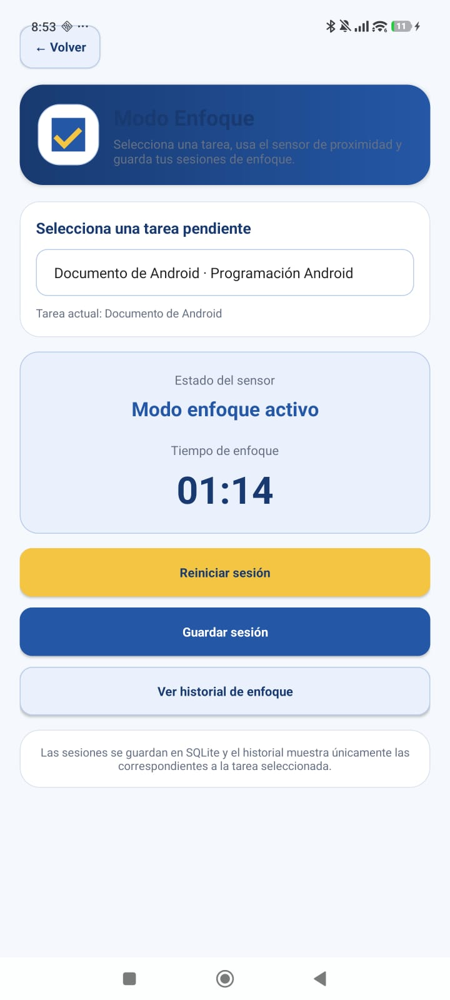
</p>

### Historial de enfoque

<p align="center">
  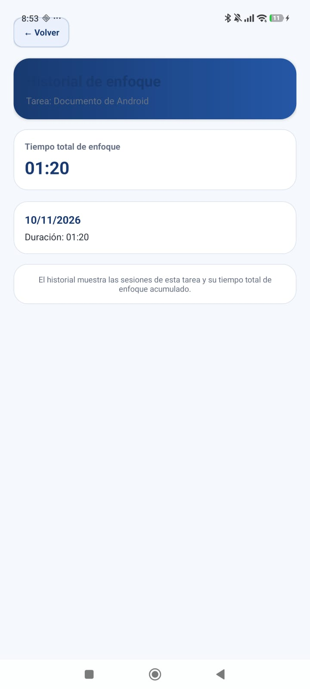
</p>

### Cerrar sesión

<p align="center">
  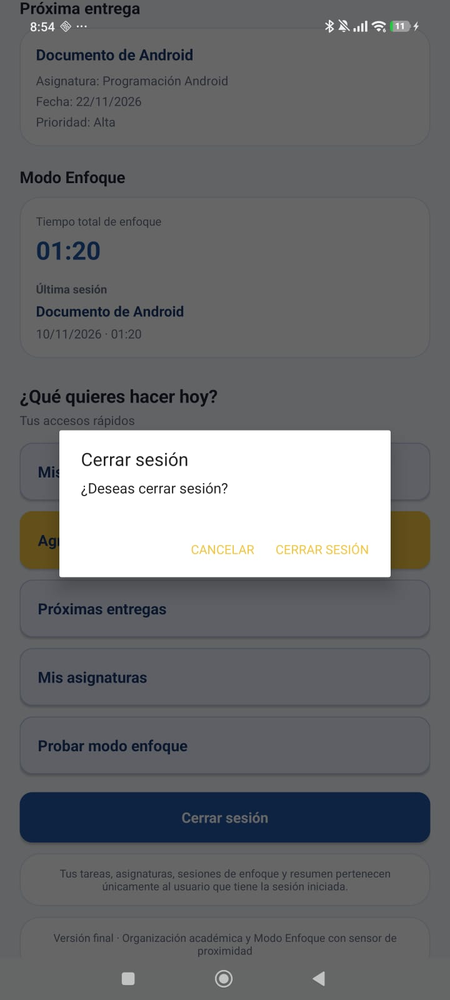
</p>

## Diagrama de Navegación y Flujo de Pantallas

<p align="center">
  
</p>

## Modelo Entidad-Relación de SQLite

<p align="center">
  
</p>

## Documentación en código

Las clases y métodos principales mantienen comentarios JavaDoc con etiquetas como `@param`, `@return` y `@throws` cuando corresponde. También se mantiene la clase `UniTaskyContract` para centralizar los nombres de tablas y columnas utilizados por SQLite.

## Informe de documentación técnica

El informe final del proyecto se encuentra dentro de la carpeta `docs`:

[Ver Informe de Documentación Técnica de UniTasky](./docs/Informe_Unitasky.docx)
